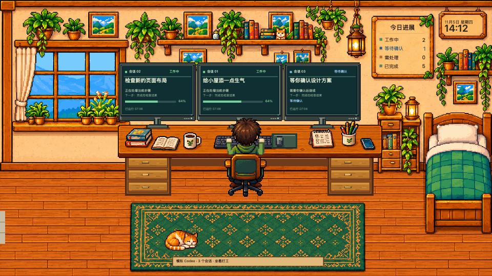
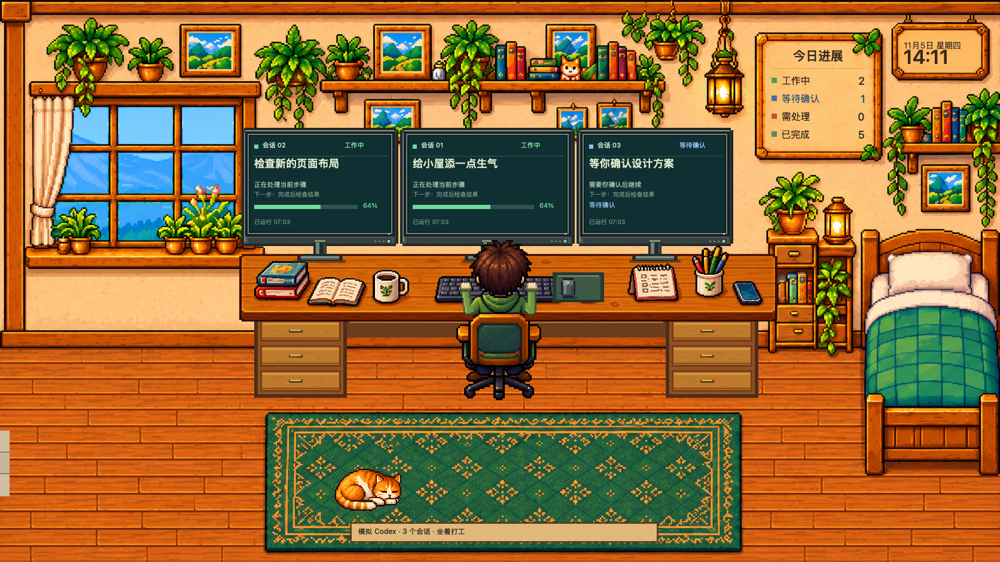
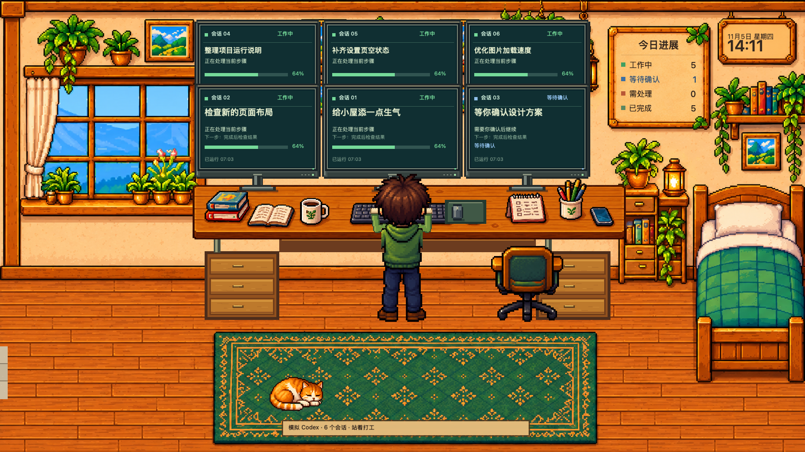
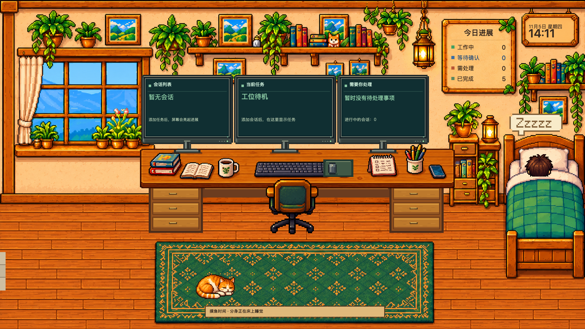
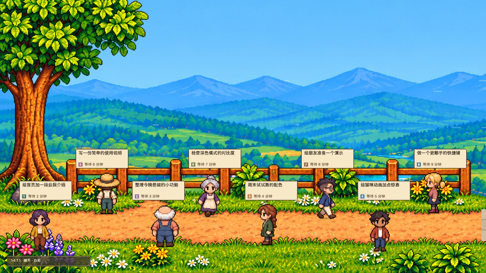
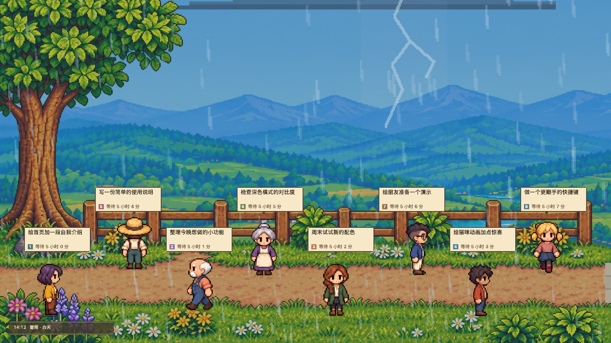
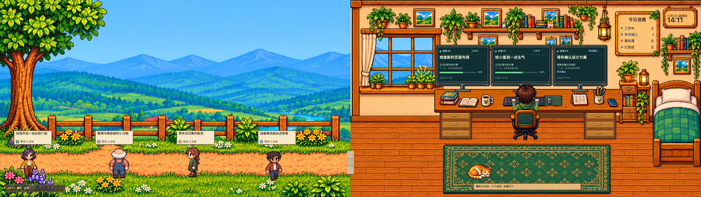

<p align="center">
  
</p>

<h1 align="center">虚拟工位</h1>

<p align="center"><strong>任务开工，小人上班。待办拖久，窗外下雨。</strong></p>

<p align="center">
  让正在进行的工作，长成一间有生活气息的像素小屋。<br>
  Codex 会话亮起一块块屏幕，没交办的便签变成门外来客。<br>
  猫在地毯上打盹，你的分身坐下、站起，偶尔也去床上睡一会。
</p>

<p align="center">
  macOS 26 · Apple Silicon · Swift · MIT<br><br>
  <a href="#preview">看看小屋</a> ·
  <a href="#notes">写张便签</a> ·
  <a href="#start">从源码运行</a> ·
  <a href="#privacy">隐私与边界</a>
</p>

<a id="preview"></a>



<p align="center"><sub>源码版本 0.9.3 · 以下展示均使用模拟会话和示例便签。</sub></p>

> **0.9.3 更新：**修复 Codex 实时同步长时间运行时的内存持续增长。旧版用户请更新并重启应用。[修复与内存复验说明](docs/MEMORY.md)

## 坐下敲键盘，站起来换换节奏，累了去睡觉

小屋里的分身有自己的工作节奏。坐着或站着时，双手交替敲键，右手偶尔移去动一动鼠标；任务告一段落，就离开桌子，到床上躺平，头顶冒出 Zzzzz。

<table>
  <tr>
    <td width="33%"></td>
    <td width="33%"></td>
    <td width="33%"></td>
  </tr>
  <tr>
    <td align="center"><strong>坐着打工</strong><br>双手敲起来，屏幕亮起来。</td>
    <td align="center"><strong>站着打工</strong><br>桌面升高，换个姿势继续。</td>
    <td align="center"><strong>躺床摸鱼</strong><br>把工位留给猫，先睡一会。</td>
  </tr>
</table>

你可以随时切换姿势，也可以让任务状态驱动分身。工作久了，它会起身在房间里溜达一圈，沿上下左右转弯，再回到工位。想让小屋热闹一点，就点一下喝咖啡、伸懒腰、挥手或逗猫；橘白猫也会醒来、甩尾、走几步，再找地方趴下。

## 一段 Codex 会话，点亮一块实体屏幕

会话多起来，屏幕就从桌面向上展开。**工作中、等待确认、出错、完成**，用文字、图标和颜色一起表达；等待你处理的事情，留在看得见的位置。

桌面常驻三块基础屏，同时最多呈现六个会话。空着的屏幕显示概览和待处理信息，忙碌的屏幕显示当前会话、工具与可用的最近进展。没有提供的进度不会被编成一个百分比。

实时模式只读映射本机，以及 Codex 桌面已经连接的开发机会话；任务和审批继续在 Codex 中处理。没有 Codex 时，可以切到模拟演示，独立体验屏幕增减和人物状态变化。

<a id="notes"></a>

## 把「等会儿再做」写下来，门外就多一位来客

一条便签，一位访客。八位来客有各自的发型、衣服和体型，在小路与草地上走走停停，头顶的气泡装着任务摘要和已经等候的时间。



要开始做时，复制任务原文，或复制并打开 Codex，再由你粘贴发送。**标记「已交办」，访客才会离开。** 重启应用后，已保存的便签和原始等待时间仍在；本次运行中，也能撤销最近一次交办。

<p align="center"><strong>⌃⌥⌘N</strong> 呼出输入框　→　写下想法　→　<strong>⌘↩</strong> 添加访客</p>

普通回车换行，Esc 收起并保留本次运行中的草稿。应用留在菜单栏时，全局快捷键也能从其他应用呼出；应用内还保留 ⌘2 入口。

## 等多久，窗外的天气会记得

待办没有被交办，晴天会慢慢变成阴天，再落下雨。默认按等得最久的一条计算：

<p align="center"><strong>1 小时 · 转阴</strong>　→　<strong>2 小时 30 分 · 下雨</strong>　→　<strong>4 小时 · 雷雨</strong></p>



交办后，天气按剩下的便签重新判断；没有超时便签时，恢复你保存的基础天气。变化节奏可以调整，也可以关闭。雷雨中的闪电只在远景局部短暂出现，室内仍留着暖灯，任务屏幕保持清晰。

## 主屏是工位，另一块屏幕可以留给窗外

给每块显示器选一个镜头：房间，或山谷庭院。它们共用同一份任务、天气与昼夜，房间的窗户也跟着窗外一起变化。

**桌面背景和系统屏保，各自保存一套布局。** 日常使用时可以让每块屏幕都保留工位信息；进入屏保后，再把一侧留给来客和风景。只有一块屏幕也能用，待办面板始终带着一扇户外预览。

同一个场景可以住进应用窗口、图标下方的动态桌面背景，以及真正的 macOS 系统屏保。关闭控制窗口后，应用留在菜单栏继续同步；完全退出时，分身进入离线休息。



<a id="start"></a>

## 把小屋搬进你的 Mac

当前提供**源码**，面向 **Apple Silicon、macOS 26**。准备好 Apple Command Line Tools，即可在本机构建；不需要额外第三方依赖、完整 Xcode 或付费 Apple 开发者账号。

<details>
<summary><strong>从源码构建并打开应用</strong></summary>

```sh
git clone https://github.com/Youlyu2/virtual-workplace.git
cd virtual-workplace
./scripts/build.sh
open build/虚拟工位.app
```

尚未安装命令行工具时，先运行 `xcode-select --install`，按系统提示完成安装。

构建脚本生成本机自用的 ad-hoc 签名应用与屏保，从源码构建自用无需 Apple 公证。若另行分发预编译安装包，应另外处理签名、公证及下载后的首次启动验证。

</details>

<details>
<summary><strong>安装桌面应用和系统屏保</strong></summary>

先完成构建，再执行：

```sh
./scripts/install.sh
open "$HOME/Applications/虚拟工位.app"
```

也可以打开构建出的 App，点击「安装屏保」。在系统设置的「墙纸 → 屏幕保护程序 → 其他」中选择 **VirtualWorkplace**，必要时展开「显示全部」。

每块显示器的背景在应用「屏幕场景」中配置。更新后若仍显示旧画面，系统可能保留了旧屏保宿主；安装文件更新不等于运行版本已刷新，详见[屏保诊断说明](docs/SCREENSAVER.md)。设置里的小缩略图固定显示房间，访客显示在户外场景。

</details>

<details>
<summary><strong>运行检查与卸载</strong></summary>

```sh
./scripts/test.sh
./scripts/test-pending-notes.sh
./scripts/test-pending-notes-panel.sh
./scripts/test-pending-visitor-sprites.sh
./scripts/test-pending-weather.sh
./scripts/test-quick-note-hotkey.sh
./scripts/diagnose-saver.sh --headless-roundtrip
```

屏保独立宿主检查使用隔离测试状态，不修改个人待办；它不能替代真实系统锁屏和多显示器测试。已验证范围与未覆盖边界见[验证说明](docs/VALIDATION.md)。

```sh
./scripts/uninstall.sh
```

卸载保留 `~/Library/Application Support/VirtualWorkplace/` 中的待办、配置和备份。

</details>

<a id="privacy"></a>

## 关于你的数据，以及这个原型的边界

数据在本机处理，没有账号系统、照片上传或云同步。应用不读取 Codex 登录凭据，不执行任务或回答审批；全局快捷键只注册指定组合键，不记录通用键盘输入。

**会话标题、可见进展和便签会显示在桌面与屏保里。** 本机数据与共享快照是明文文件，使用时请按所处环境决定展示什么。读取范围与数据路径见[隐私说明](docs/PRIVACY.md)。

Codex 实时接入目前是**实验性的桌面内部 IPC 兼容层**，不是官方稳定 hook，桌面更新后可能需要适配。远端会话沿用 Codex 桌面已有连接；独立 CLI 会话和任意云端作业不在当前范围。详细原理见[Codex 接入说明](docs/CODEX.md)。

当前是早期原型，尚不覆盖 Intel Mac、较早的 macOS，以及所有显示器和长期锁屏/睡眠唤醒组合。系统启用减少动态效果时，小屋也会安静下来。更多操作见[功能说明](docs/FEATURES.md)。

README 展示媒体由生产渲染器和固定的示例任务生成；可运行 `./scripts/render-showcase.sh` 重新生成，不会读取个人会话、便签或屏幕配置。

## 一起添一点生活气

欢迎带着复现步骤提问题，或为动作、场景、适配和测试贡献修改。问题截图请使用模拟数据，避免带上个人会话和便签。[贡献说明](CONTRIBUTING.md) · [版本管理](docs/VERSION_CONTROL.md)

软件代码采用 [MIT License](LICENSE)，像素素材、图标和设计图的来源及条件见[素材许可说明](ASSET_LICENSE.md)。这是一个使用原创生成素材的独立项目；各资源目录保留了 imagegen 生成提示词。
